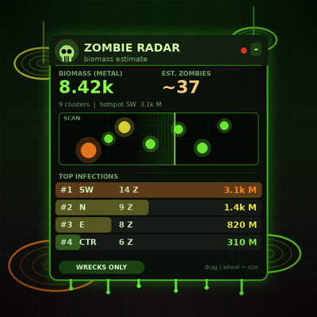

# Zombie Radar

A draggable, zombie-themed HUD that estimates how much **zombie biomass** is lying around the map and where it is clustered. Built for Zombies-mode games, where wrecks come back as zombies, but it works in any game as a wreck/metal overview.

## How it works

- Scans every feature you can see and keeps the ones that can be resurrected (wrecks). Each one counts as one future zombie, and its remaining metal is the biomass.
- Touching wrecks are grouped into clusters on a ~350 elmo grid.
- Clusters are coloured by metal: green, then yellow, orange and red for the biggest.
- Only features you can see are counted (your LOS/radar, or everything when spectating with full view), so the numbers are an **estimate** and reveal nothing you couldn't already see.

## What you get

- **HUD panel:** total biomass, estimated zombie count, hotspot sector, a radar thumbnail with a sweep and your camera position, and a ranked list of the top clusters.
- **World markers:** pulsing ground rings, light beams and labels (metal and zombie count) over each cluster.
- **Minimap:** a blob for every cluster.
- **Hover highlight:** hovering a list row or radar blip highlights that cluster in the world and on the minimap.

## Controls

| Action | Result |
| --- | --- |
| Drag the panel | Move it |
| Mouse wheel over the panel | Resize |
| Click a list row or radar blip | Jump the camera to that cluster |
| Click the `-` / `+` button | Collapse / expand |
| Click the footer pill | Toggle **WRECKS ONLY** and **ALL METAL** (also counts map rocks and heaps) |

Position, size, collapse state and mode are saved between sessions.

## Settings

Constants at the top of `gui_zombie_radar.lua`:

- `CELL`: clustering grid size. Smaller values split dense battlefields into more clusters.
- `SCAN_INTERVAL`: seconds between rescans.
- `MAX_ROWS`, `MAX_CLUSTERS`, `MAX_WORLD_LABELS`: how much is listed and drawn.
- `MINIMAP_UNIT_SPACE`: set to `false` if minimap blobs appear misplaced.

## Links

- Discord: https://discord.com/channels/549281623154229250/1565483540076822599
- GitHub: https://github.com/bitopsy/BAR-Widgets/tree/main/Widgets/community/gui_zombie_radar

License: GNU GPL v2 or later.
